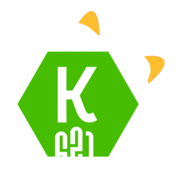

<div align="center">
  
  <div align="left">
    <h3>kiwi621</h3>
    <p>plugin and theme loader for furry image boards! 🐾</p>
  </div>
</div>
<hr>


<i>README is a W.I.P, this should give you quite a bit of information anyways</i>

## What is it exactly?
kiwi621 is a browser extension that allows you to modify the e621/e926 site with custom features and themes made by the community.

### Cool! How do I get it?
You can grab the latest version of kiwi621 from <a href="https://github.com/cyanpurr/kiwi621/releases">Releases</a> and install it by going to `chrome://extensions`, enabling Developer Mode then dragging and dropping the file into the window.  
Once installed, going to e621 will show a bright green "kiwi621" link in the top bar. Have fun!

## Building
To build kiwi621, you must install the latest NodeJS with NPM (will come with NodeJS in most cases) and Python3 for the simple webserver.
```bash
# Setup variables (optional for most)
set CHROME_PATH=...     # Path to chrome.exe or a different executable. Optional if chrome.exe is in PATH.
set LIBRARY=...         # URL to where the kiwi621 library is located. http://localhost:8621 is the default.

# Setup the project
npm install

# Build the project
npm run build           # for public library
npm run build:local     # for local or custom library
```
You will now see `extension.crx` in your projects folder which is the packed Chrome extension you can install in your browser.  
If you want to start the webserver for your library, run `python -m http.server 8621` in your projects folder.

### Theme Creation
Quite a bit of HTML, CSS and understanding of DevTools is required. If you know these then that's great!  
When you do make your custom theme in CSS after looking into how different pages HTML looks, you can test your theme through e621's [Custom CSS](https://e621.net/users/settings?tab=advanced) feature.
### Submit your theme
Fork this GitHub repository and drop the .css file into `library/themes/` then edit `library/themes.json` to add your theme like this:
```json
[
  {
    "id": "kiwi621",
    "name": "Kiwi621",
    "author": "cyanpurr",
    "short": "The Kiwi621 Theme.",
    "url": "themes/Kiwi621.css"
  },
  {
    "id": "my-cool-amazing-EPIC-theme",   <-- Named after your theme name.
    "name": "My Cool Amazing EPIC Theme!!!",
    "author": "xX_epicfurrygamer621_Xx",   <-- Your e621 username or a username you frequently go by if people want to contact you.
    "short": "Makes the whole page invisible!!! Hehehehe...",   <-- A short description of your theme.
    "url": "themes/MyCoolAmazingEPICTheme.css"   <-- Where the file is located.
  }
]
```
Submit a Pull Request after you upload your theme and make sure everything is correct.  
You can also attach a screenshot of what your theme looks like in different areas, would be helpful.
### Do NOT...
- Anything that will break functionality of a feature on the site.
- Hide something or do completely random stuff for absolutely no good reason.
- Use assets such as artwork and other media without any permission from the authors.
- Include stuff that just doesn't work at all or looks bad visually.

## Plugin Development
It's pretty the same instructions above. Fork this repo, add your JS file in `library/plugins/` and edit `library/plugins.json` to include your plugin so people can download it from kiwi621 then submit a Pull Request. An example of a "Hello, World!" plugin is:
```js
// Adds a link on the top bar to navigate over to the "secret" /kiwi/hello page.
kiwi621.addTopLink({
  id: "kiwi-helloworld",
  label: "Hello",
  href: "/kiwi/hello",
  title: "Hello",
  after: "#nav-kiwi621"
});
```
### kiwi621 functions
There are super cool kiwi621 functions you can use in your plugins to simplify doing specific stuff on the site and should be used instead of your own DIY function (You can take a look at some of the plugins that already exist for more usage examples):
- `kiwi621.addTopLink({ id, label, href, title, after, before, onClick })` adds a topbar link.
- `kiwi621.removeTopLink(id)` removes a topbar link.
- `kiwi621.addSubnavLink({ id, label, href, title, location, after, before })` adds a sub-navigation link. Location can be a path or an array of paths, including wildcards such as `/posts/*` so you can lock to specific pages only.
- `kiwi621.registerRoute({ path, title, content, sitemap })` creates a custom page on the site. Setting sitemap to `true` will add your route to the [e621 site map](https://e621.net/static/site_map) which is shown by clicking More on the top bar.
- `kiwi621.important({ title, content, buttons })` opens a message that covers the whole screen.
- `kiwi621.getSetting(key, fallback)` gets a setting from the plugin.
- `kiwi621.setSetting(key, value)` sets a setting from the plugin.
- `kiwi621.removeSetting(key)` removes a setting from the plugin.
- and a lot more to come soon...
### Updating a plugin
If you change the plugin code and bump up the `x.y.z` version for your plugin in `library/plugins.json`, it will show an Update button in the kiwi621 plugins list.
### Do NOT...
- Anything that will break functionality of a feature on the site.
- Hide something or do completely random stuff for absolutely no good reason.
- Use assets such as artwork and other media without any permission from the authors.
- Include stuff that just doesn't work at all or looks bad visually.
- Send a ton of requests to the e621 API at once.
- Include anything malicious in the plugin code such as account stealers.
- Run the plugin code through a JS minimizer. This will make reviewing code hell for me so don't do it for the love of god.
- Run the plugin code through an obfuscator. If you don't want people to see your code, that's really suspicious. Stop it.
